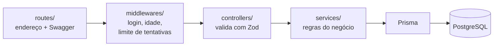
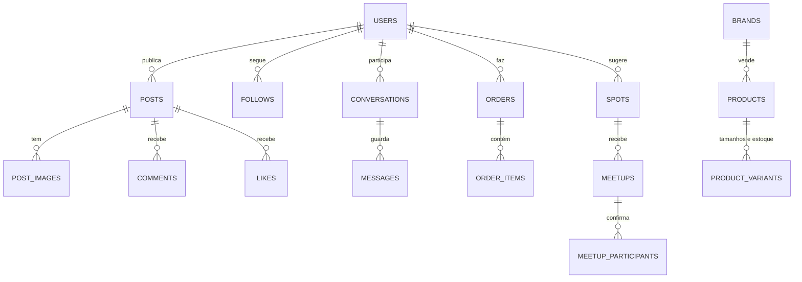

<div align="center">


# Clutch — API (backend)

**A API da rede social do skatista:** contas, comunidade, chat, loja, spots e encontros.


Trabalho de Conclusão de Curso · turma DS2A · 2026<br>
**André Camacho · Gabriel Neri · Guilherme Sales · Tito Leal**

[Arquitetura](#arquitetura) · [Rotas](#rotas) · [Banco de dados](#banco-de-dados) · [Segurança](#segurança) · [Como rodar](#como-rodar) · [Testes](#testes)

</div>

---

## O projeto

O Clutch é uma rede social feita para skatistas, com três frentes: **spots e encontros no mapa**, **comunidade** (feed e chat) e **loja** de streetwear. Este repositório é a **API**: recebe os pedidos do site, aplica as regras do negócio e guarda tudo no banco.

| Repositório | O que é |
|---|---|
| [ProjetoTCC_WEB_REACTJS](https://github.com/AndreCamacho-byte/ProjetoTCC_WEB_REACTJS) | Site em React + TypeScript |
| **ProjetoTCC_WEB_BACKEND** (este) | API em Express, banco PostgreSQL e documentação Swagger |
| Terraform_TCC_WEB_REACT (privado) | Infraestrutura na AWS, criada por código |

### Em números

| 97 rotas | 28 tabelas | 17 migrations | 462 testes |
|:---:|:---:|:---:|:---:|
| documentadas no Swagger | no PostgreSQL | versionadas no Git | sem precisar de banco |

## Arquitetura

Todo pedido percorre as mesmas camadas, cada uma com uma responsabilidade:



Erros esperados (produto esgotado, código expirado, conta suspensa…) são lançados com `throw new AppError(mensagem, status, código)` e viram respostas JSON padronizadas no `middlewares/errorHandler.ts`.

## Tecnologias

| Tecnologia | Para que usamos |
|---|---|
| **Node.js 22 + Express 5** | Servidor HTTP e as 97 rotas da API |
| **TypeScript** | Tipos em todo o código, inclusive nos testes |
| **Prisma 6** | Acesso ao banco e migrations, sem SQL escrito à mão |
| **PostgreSQL (Aiven)** | Banco na nuvem, fora da AWS: recriar as máquinas não perde dados |
| **Zod** | Validação de tudo que chega nas rotas |
| **JWT + bcrypt** | Sessão de login e senhas guardadas só como hash |
| **Nodemailer (Gmail)** | Códigos de confirmação, de login e links de nova senha |
| **Swagger (OpenAPI)** | Documentação interativa em `/api/docs` |
| **Vitest + Supertest** | Testes dos serviços e das rotas |

## Rotas

A lista completa, com o que mandar e o que volta, está no **Swagger em `/api/docs`**.

| Área | Prefixo | Acesso |
|---|---|---|
| Status | `/health` | Público |
| Cadastro e login | `/auth/register`, `/auth/verify-code`, `/auth/verify-email`, `/auth/login`, `/auth/login/verify`, `/auth/forgot-password`, `/auth/reset-password`, `/auth/me` | Público (o `/me` exige login) |
| Conta | `/users/me` (perfil, foto, senha, data de nascimento, aparelhos, exclusão) | Login |
| Comunidade | `/posts`, `/comments`, `/profiles`, `/saved/posts`, `/blocks` | Login |
| Chat | `/friends`, `/chats` | Login, só entre amigos |
| Denúncias | `/reports` | Login |
| Loja | `/products`, `/brands` (públicos), `/cart`, `/orders`, `/saved/products` | Login + 13 anos para comprar |
| Spots e encontros | `/spots`, `/meetups` | Login + 13 anos |
| Painel | `/admin/users`, `/admin/products`, `/admin/brands`, `/admin/orders`, `/admin/spots`, `/admin/reports` | Só administrador |

## Banco de dados

**28 tabelas** descritas em [`prisma/schema.prisma`](prisma/schema.prisma), criadas por **17 migrations** em `prisma/migrations/`. As principais relações:



| Área | Tabelas |
|---|---|
| Contas | `users`, `user_avatars`, `email_verification_tokens`, `login_codes`, `trusted_devices`, `password_reset_tokens` |
| Comunidade | `posts`, `post_images`, `comments`, `likes`, `follows`, `saved_posts`, `blocks` |
| Chat e moderação | `conversations`, `messages`, `reports` |
| Loja | `brands`, `products`, `product_variants`, `product_images`, `cart_items`, `orders`, `order_items`, `saved_products` |
| Spots | `spots`, `spot_images`, `meetups`, `meetup_participants` |

Decisões: as fotos ficam no próprio banco (JPEG de até 600 KB); senhas, códigos e tokens ficam só como hash; excluir uma conta apaga em cascata os dados dela; o pedido guarda uma cópia do produto e do preço, então mudar o produto não altera pedidos antigos.

## Regras de negócio (destaques)

- **Idade mínima de 13 anos** em todo o site, conferida na API (`requireMinAge`).
- **Login em duas etapas:** senha + código de 6 dígitos por email (10 min, 5 tentativas, uso único), com opção de lembrar o aparelho por 30 dias.
- **Chat só entre amigos** (as duas pessoas se seguem).
- **Spots sugeridos passam pelo admin** (pendente → aprovado ou recusado); encontros só em spots aprovados, nos próximos 90 dias, com limite de 2 a 50 pessoas.
- **Compra “tudo ou nada”:** o estoque de todos os itens é baixado numa transação; se faltar um, nada é gravado.
- **Pedido:** pago → enviado → entregue; pago ou enviado pode ser cancelado, devolvendo o estoque. O pagamento é simulado.

## Segurança

| Proteção | Como funciona |
|---|---|
| Senhas | bcrypt; códigos e links de email guardados só como hash |
| Sessão | Token JWT conferido no banco a cada pedido: conta excluída ou suspensa perde o acesso na hora, e trocar a senha encerra os outros logins |
| Limite de tentativas | Por IP e por conta: login, cadastro, emails, posts, comentários, mensagens, spots e denúncias |
| Privacidade | O email de uma pessoa nunca aparece para as outras, nem no painel do admin |
| Moderação | Denunciar, bloquear e suspender contas, com fila no painel |
| Segredos | Senhas e chaves só no `.env`, que nunca vai para o GitHub |

## Como rodar

```bash
npm install
cp .env.example .env      # preencha a DATABASE_URL e o JWT_SECRET
npm run db:deploy         # cria as tabelas no banco (aplica as migrations)
npm run dev               # sobe a API e recarrega ao salvar
```

| Endereço | O que é |
|---|---|
| http://localhost:3000/api | API |
| http://localhost:3000/api/docs | Documentação (Swagger) |
| http://localhost:3000/api/health | Status da API e do banco |

Sem `SMTP_USER` e `SMTP_PASS`, nenhum email é enviado: os códigos aparecem no terminal, o que serve para testar no computador.

<details>
<summary><b>Variáveis de ambiente</b></summary>

Ficam no arquivo `.env` (modelo em `.env.example`).

| Variável | Para que serve |
|---|---|
| `DATABASE_URL` | Conexão com o PostgreSQL |
| `JWT_SECRET` | Chave que assina os tokens de login (pelo menos 32 caracteres) |
| `SMTP_USER` e `SMTP_PASS` | Envio de emails pelo Gmail do projeto (senha de app do Google) |
| `ADMIN_EMAILS` | Emails, separados por vírgula, das contas administradoras |
| `PORT`, `CORS_ORIGIN`, `APP_URL`, `JWT_EXPIRES_IN` | Opcionais |

</details>

<details>
<summary><b>Scripts</b></summary>

| Script | O que faz |
|---|---|
| `npm run dev` | Sobe em modo desenvolvimento (recarrega ao salvar) |
| `npm start` | Compila o TypeScript e sobe a versão de produção (usado pelo PM2 na AWS) |
| `npm run db:migrate` | Cria uma migration a partir do `schema.prisma` e aplica no banco |
| `npm run db:deploy` | Aplica as migrations existentes |
| `npm run db:studio` | Abre o Prisma Studio para ver os dados |
| `npm test` | Roda os testes automáticos |
| `npm run typecheck:tests` | Confere os tipos dos arquivos de teste |

</details>

<details>
<summary><b>Estrutura de pastas</b></summary>

```
src/
├── config/        variáveis de ambiente validadas
├── routes/        endpoints + documentação Swagger (@openapi)
├── controllers/   validam os dados (Zod) e devolvem a resposta
├── services/      regras de negócio
├── middlewares/   login (requireAuth), administrador, idade mínima, limite de tentativas, erros
├── emails/        modelos dos emails (confirmação, código de login, nova senha)
├── lib/           Prisma e envio de email (SMTP)
├── utils/         idade, fotos JPEG, @username
├── errors/        AppError
├── docs/          configuração do Swagger
├── test/          banco simulado e preparo dos testes
├── app.ts         configuração do Express (cabeçalhos de segurança, limites de tamanho)
└── server.ts      inicialização
prisma/
├── schema.prisma  modelo do banco
└── migrations/    histórico das mudanças do banco
```

</details>

## Testes

```bash
npm test
```

**462 testes em 18 arquivos**, todos passando. Não precisam de banco nem de internet: o Prisma e o envio de email são substituídos por versões simuladas (`src/test/prismaMock.ts`).

| Arquivos | O que testam |
|---|---|
| `services/auth.service.test.ts` | Cadastro, @username único, confirmação de email, login com código, aparelhos confiáveis, nova senha |
| `services/account.service.test.ts`, `admin.service.test.ts` | Configurações da conta e painel do administrador |
| `services/community.service.test.ts`, `chat.service.test.ts` | Feed, posts, edição, comentários, seguir e chat só entre amigos |
| `services/moderation.service.test.ts` | Denúncias, bloqueios e suspensão |
| `services/market.service.test.ts` | Catálogo, carrinho, fechamento do pedido (estoque) e situação dos pedidos |
| `services/spot.service.test.ts` | Spots com aprovação, encontros, limite de pessoas e cancelamento |
| `middlewares/*.test.ts` | Token, administrador, idade mínima, limite de tentativas e respostas de erro |
| `routes/*.test.ts` | As rotas por fora: validação, códigos de resposta e proteções |
| `utils/age.test.ts`, `emails/emails.test.ts` | Cálculo da idade e conteúdo dos emails |

## Publicação (deploy)

A API roda na AWS, numa máquina criada com Terraform. Ao ser criada, a máquina baixa este repositório, roda `npm install` e `prisma migrate deploy` e sobe a API com o PM2, que a religa se ela cair. Só a máquina do site consegue falar com a API (porta 3000 liberada apenas para ela), e o Nginx de lá repassa tudo o que começa com `/api`.

---

<div align="center">
<sub><b>clutch.</b> — for those who shred</sub>
</div>
